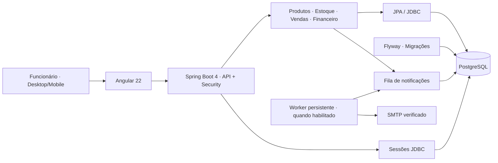

<div align="center">

# 🔩 LOJA FERRAGENS
### Sistema Full Stack de Gestão de Estoque e Vendas

**Produtos, estoque, vendas, clientes, fornecedores, compras e financeiro em um só lugar.**

[](https://github.com/WalterMatheusgg/SistemaMercearia/actions/workflows/ci.yml)


**Status: desenvolvimento e homologação · Ainda não aprovado para operação comercial**

[Funcionalidades](#-funcionalidades) · [Tecnologias](#-tecnologias) · [Arquitetura](#-arquitetura) · [Instalação](#-executar-localmente) · [Hospedagem](#-hospedagem-e-estado-atual) · [Documentação](#-documentação)

</div>

---

## 🎯 Sobre o projeto

A **Loja Ferragens** é uma aplicação Full Stack para a gestão interna de uma loja de materiais e ferragens. Centraliza tarefas do balcão e do estoque com regras de negócio no servidor, controle de acesso por funcionário, dados persistidos e histórico das operações.

O repositório se chama **SistemaMercearia**, enquanto a marca apresentada na interface é **Loja**. O frontend Angular e a API Spring Boot são distribuídos juntos no mesmo domínio, com autenticação por sessão.

> **Escopo:** controle interno. A aplicação não realiza cobranças bancárias, emissão fiscal ou checkout público. Pix, cartão e transferência são conferidos externamente e registrados pela equipe.

## ✨ Funcionalidades

| Módulo | Recursos implementados |
|:--|:--|
| 📊 **Painel** | Indicadores e atalhos para as principais operações |
| 🧱 **Produtos** | Cadastro com categoria, marca, unidade, preço, quantidade inicial e foto opcional |
| 📦 **Estoque** | Entrada, saída, contagem, perda, mínimo, estorno, reposição sugerida e histórico |
| 🛒 **Vendas** | Seleção de itens, conferência do total, descontos autorizados, pagamentos e devoluções |
| 👥 **Clientes e fornecedores** | Cadastros, contatos e vínculos com operações |
| 🚚 **Compras** | Pedidos e recebimentos parciais ou integrais, com atualização do estoque |
| 💰 **Financeiro e caixa** | Contas, pagamentos, recebimentos e movimentos de dinheiro |
| 📈 **Relatórios** | Vendas, pagamentos, custos, estoque e exportação CSV |
| 🔐 **Equipe** | Usuários, autenticação e permissões por função |
| ✨ **Assistente** | Consultas internas, importação em lote com prévia e IA externa opcional |
| ✉️ **Notificações** | Preferências e fila transacional; envio real exige SMTP e worker persistente |

### Estoque com rastreabilidade

A interface oferece alternância entre **cartões e lista**, imagens inteiras, botões adaptados ao toque e filtros por categoria. Movimentações exigem motivo e registram o responsável. O backend aplica controle de concorrência e idempotência para evitar duplicidade; estornos preservam o registro original.

## 📱 Responsividade

A navegação tem menu lateral recolhível no desktop, menu adaptado a celular e busca rápida por **Ctrl + K** / **⌘ + K**. A suíte de navegador testa desktop e mobile, incluindo cartões do estoque em **320, 390, 600, 760 e 1280 px**.

Testes automatizados não substituem homologação visual em dispositivos reais.

## 🧰 Tecnologias

| Camada | Ferramentas |
|:--|:--|
| **Backend** | Java 21 · Spring Boot 4.1 · Spring MVC · Spring Security · Spring Data JPA |
| **Frontend** | Angular 22 · TypeScript 6 · Angular Material · SCSS |
| **Persistência** | PostgreSQL · Hibernate · Flyway · Spring Session JDBC |
| **Segurança** | Cookies HttpOnly · CSRF · BCrypt · Permissões no backend |
| **Qualidade** | JUnit · Mockito · Testcontainers · Vitest · Playwright |
| **Infraestrutura** | Docker · Docker Compose · GitHub Actions · Supabase · Vercel (homologação) |
| **E-mails de desenvolvimento** | Mailpit |

## 🏗️ Arquitetura

O projeto é um **monólito modular**: o Spring Boot serve a interface Angular e a API REST na mesma origem.



```text
SistemaMercearia/
├── backend/            # API, segurança, serviços e migrações
├── frontend/           # Angular e testes de navegador
├── infra/              # Docker Compose de produção e HTTPS
├── scripts/            # Inicialização, backups e sincronização
├── docs/               # Arquitetura, operação e hospedagem
├── .github/workflows/  # CI
├── Dockerfile          # Build Angular + Spring Boot
└── compose.yaml        # Ambiente local
```

[Arquitetura](docs/ARQUITETURA.md) · [Modelo de dados](docs/MODELO_DADOS.md) · [Regras de negócio](docs/REGRAS_NEGOCIO.md)

## 🚀 Executar localmente

**Pré-requisitos:** Git, Docker Engine e Docker Compose v2. Para desenvolvimento fora do Docker: JDK 21, Node.js 24 e npm compatível.

```bash
git clone https://github.com/WalterMatheusgg/SistemaMercearia.git
cd SistemaMercearia
bash scripts/start.sh
```

| Serviço | Endereço |
|:--|:--|
| **Loja + API** | http://localhost:8080 |
| **Health** | http://localhost:8080/actuator/health |
| **Mailpit local** | http://localhost:8025 |

Para conferir o ambiente sem gravar produtos nem vendas, execute `bash scripts/smoke.sh`. Não há senha pública padrão: use `bash scripts/admin-access.sh` ou `python3 scripts/owner-setup.py` para administrar o acesso **local** no terminal privado.

### Sincronizar GitHub e Codespaces

```bash
cd /workspaces/SistemaMercearia
git status --short
git switch main
git pull --ff-only origin main
bash scripts/sync-codespace.sh
```

O script preserva alterações locais, realiza backup quando o banco local está configurado e executa testes. Mantenha uma cópia dos backups fora do Codespace. Nunca use `git reset --hard` ou `docker compose down -v` sem um plano explícito de recuperação.

[Guia do Codespaces](docs/CODESPACE.md)

## 🧪 Testes e integração contínua

```bash
./mvnw -pl backend test
npm --prefix frontend ci
npm --prefix frontend test -- --watch=false
npm --prefix frontend run build
```

O [GitHub Actions](https://github.com/WalterMatheusgg/SistemaMercearia/actions/workflows/ci.yml) executa testes Java/PostgreSQL, frontend e cenários de navegador desktop/mobile. **Não execute testes E2E que criam registros no banco de produção.**

## 🔐 Segurança e limites

- Controle por papéis, sessão HttpOnly, CSRF, senhas com BCrypt e autorizações no backend.
- Movimentações e documentos comerciais têm histórico, transações e proteção contra operações duplicadas.
- Credenciais de banco, SMTP e IA ficam em variáveis privadas. Não versione `.env`.
- Cadastro externo e vitrine pública estão desativados por padrão.
- Não há emissão fiscal nem integração bancária automática de Pix/cartão.
- Notificações externas exigem SMTP, destinatários verificados e worker persistente; os jobs estão **desativados no perfil Vercel**.

## 🌐 Hospedagem e estado atual

| Ambiente | Situação |
|:--|:--|
| **Docker / Codespaces** | Desenvolvimento local |
| **Vercel + Supabase** | Homologação com login da própria aplicação |
| **Railway** | Perfil Java persistente preparado, **não implantado** |
| **VM Docker + HTTPS** | Alternativa documentada, não provisionada |

**Demonstração:** [loja-ferragens.vercel.app/login](https://loja-ferragens.vercel.app/login)

> O ambiente Vercel apresentou inicializações do Java em torno de **18–21 segundos** e limite de conexões do pool do Supabase. Uma mitigação reduziu conexões por instância, mas a correção estrutural exige hospedagem persistente, monitoramento e testes. **A Loja ainda não foi homologada para operação comercial.**

[Hospedagem](docs/HOSPEDAGEM.md) · [Railway](docs/RAILWAY.md) · [Vercel + Supabase](docs/VERCEL_SUPABASE.md)

## 📚 Documentação

| Guia | Conteúdo |
|:--|:--|
| [Operação](docs/OPERACAO.md) | Fluxos e limites de negócio |
| [Arquitetura](docs/ARQUITETURA.md) | Organização, segurança e notificações |
| [Estoque](docs/ESTOQUE.md) | Movimentações, saldos e APIs |
| [Codespaces](docs/CODESPACE.md) | Inicialização e sincronização |
| [Hospedagem](docs/HOSPEDAGEM.md) | HTTPS, backups e requisitos de produção |
| [Railway](docs/RAILWAY.md) | Alternativa persistente com Supabase |
| [Notificações](docs/ADMIN_NOTIFICACOES.md) | SMTP, destinatários e jobs |
| [Revisão técnica](docs/REVISAO_TECNICA_2026-11-07.md) | Diagnósticos e pendências |
| [Roadmap](docs/ROADMAP.md) | Melhorias futuras |
| [GitHub About](docs/GITHUB_ABOUT.md) | Descrição, site e tópicos |

---

<div align="center">

**LOJA FERRAGENS · Gestão interna, rastreabilidade e Full Stack**

Desenvolvido por **[Walter Matheus](https://github.com/WalterMatheusgg)**

</div>
