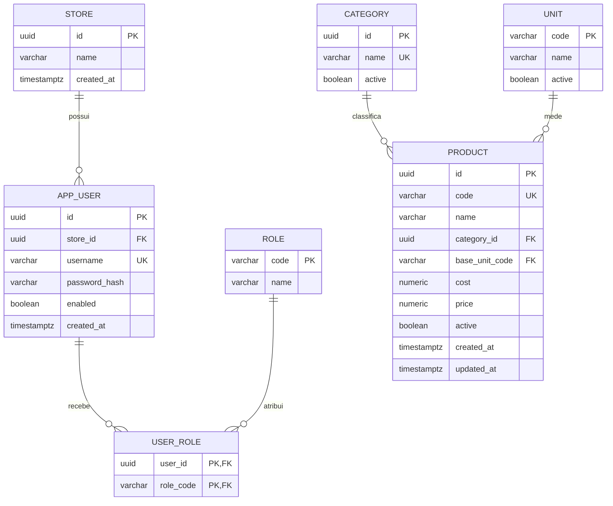

# Modelo de dados

## Persistido nesta etapa

`product.cost` e `product.price` são `NUMERIC(14,2)` e não nulos/não negativos. IDs são UUID. `code` é único no banco e normalizado para maiúsculas na aplicação. `DELETE /api/admin/products/{id}` é inativação lógica. Não há coluna de quantidade ou estoque no produto.

V1 também insere uma loja principal, sete papéis planejados, categorias iniciais e unidades `UN`, `M`, `KG` e `L`. Esses dados iniciais não são produtos nem estoque simulado.

## Planejado, ainda sem tabelas

| Área | Entidades a modelar quando o módulo começar |
| --- | --- |
| Produtos | Marca, variação/SKU, embalagem e fator de conversão, quando casos de uso confirmarem cardinalidade |
| Clientes | Cliente, endereços, contatos verificados e identificadores protegidos |
| Compras | Fornecedor, pedido de compra, item, recebimento parcial e documento de origem |
| Estoque | Localização, movimento imutável, reserva, lote quando necessário, contagem e ajuste auditado |
| Venda | Orçamento, pedido, venda, itens com snapshot de nome/código/preço/tributação e cancelamento/devolução |
| Caixa e pagamentos | Sessão de caixa, lançamento por meio, liquidação, título a pagar/receber e conciliação |
| Entrega | Opção de fulfillment, reserva, coleta/expedição e comprovante de entrega |
| Auditoria | Evento de domínio/ator/instante/correlação com política de retenção definida |
| E-mail | Preferência/contato verificado, outbox, tentativas e histórico de envio |

## Invariantes para o desenho futuro

- Registrar entradas/saídas como movimentos; correções geram movimentos compensatórios, não edição destrutiva do passado.
- Reservar com transação concorrente e bloqueio/controle otimista de disponibilidade; nunca aceitar comprometimento maior que disponível.
- Snapshot dos dados comerciais por linha de venda para preservar o histórico após alteração do cadastro/preço.
- Separar fato de venda, recebimento e liquidação financeira; pagamento posterior não cria outra venda.
- Outbox comercial deve ser gravada junto da transação do domínio que publica o evento.